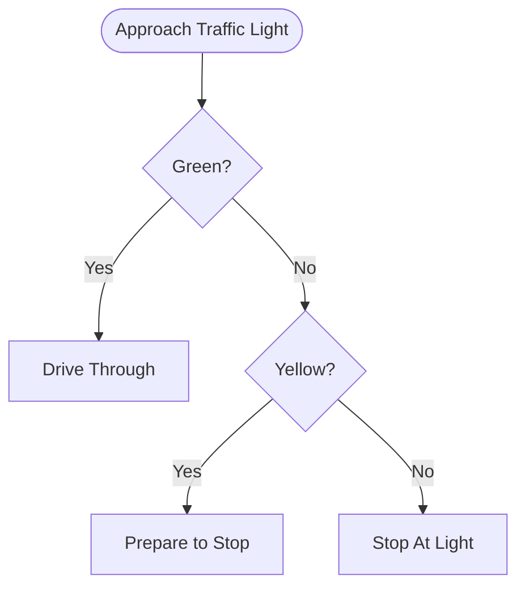
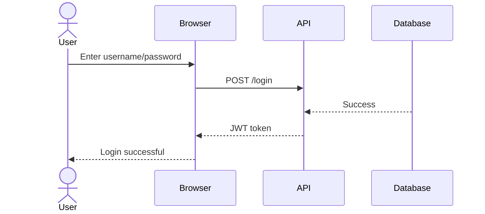
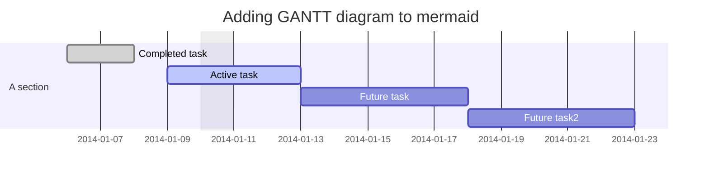
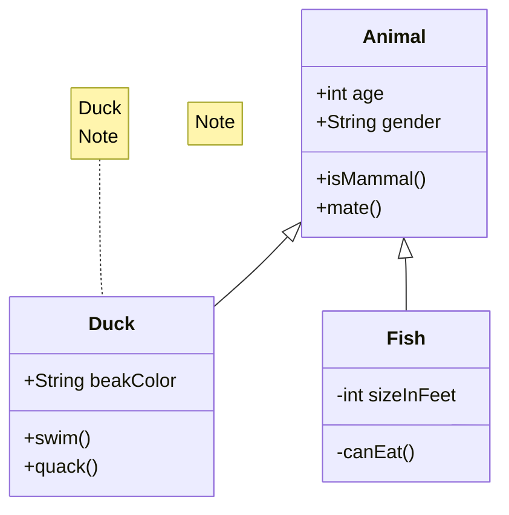

# Mermaid in 5min

Intended to be brief, to the point, reference guide. For more information, refer to [Mermaid's documentation](https://mermaid.js.org/intro/).

---

## Introduction

Mermaid is a JavaScript based diagramming tool that renders Markdown *inspired*
text to create diagrams dynamically. You should already be familiar with using
basic Markdown syntax from our [earlier guide](../markdown/index.md), but feel
free to review in case a refresher is needed.

I just like it because its more centralization, I can do everything in Markdown,
render with Zensical, and publish a static site in literal seconds.

---

## Diagram Types

### Flowchart

We can use a [flowchart](https://mermaid.js.org/syntax/flowchart.html?id=flowcharts-basic-syntax) to describe the flow of events in order.

Take for example, you are driving and approach a traffic intersection:



* The person driving starts to approach the traffic signal
* A decision must be made whether to drive, stop, or slow down
* The color of the traffic signal determines the answer

!!! example
    !!! tip
        Can also use `graph`

    ```markdown
    flowchart TD
      A-->B
      A-->C
      B-->D
      C-->D
    ```

---

### Sequence diagram

We can use a [sequence diagram](https://mermaid.js.org/syntax/sequenceDiagram.html) to tell a story in order of events.

Take for example, a social media platform:



* A user enters in their User Name & Password to their login client
* The entered credentials then send a POST request via the API between the front
and backend systems validating the entered in credentials against the database.
* If the credentials are valid, the API returns a SUCCESS, which then provides
the JWT authentication token users can use to navigate in the system.

!!! example
    ```markdown
    sequenceDiagram
    actor User
    participant Browser
    participant API
    participant Database

    User->>Browser: Enter username/password
    Browser->>API: POST /login
    Database-->>API: Success
    API-->>Browser: JWT token
    Browser-->>User: Login successful
    ```

---

### Gantt diagram

A [Gantt chart](https://mermaid.js.org/syntax/gantt.html) is useful for describing how long something will take.

For example take a handful of tasks:



This is useful in displaying visually without saying in words,
"this task took x days" to complete. It tracks start and end dates,
and keeps a timeline.

!!! example
    ```markdown
    gantt
    dateFormat  YYYY-MM-DD
    title Adding GANTT diagram to mermaid
    excludes weekdays 2014-01-10

    section A section
    Completed task            :done,    des1, 2014-01-06,2014-01-08
    Active task               :active,  des2, 2014-01-09, 3d
    Future task               :         des3, after des2, 5d
    Future task2               :         des4, after des3, 5d
    ```

---

### Class diagram

A [class diagram](https://mermaid.js.org/syntax/classDiagram.html) is one of the
main building blocks of object-oriented modeling. It is used for general conceptual
modeling of the structure of an application, and for detailed modeling to translate
the models into programming code.

Say you are building a game and already have an `Animal` base class:



!!! example
    ```markdown
    ```

---

### Git graph

```mermaid

```

!!! example
    ```markdown
    ```

---

### Entity Relationship Diagram

```mermaid

```

!!! example
    ```markdown
    ```

---

### User Journey Diagram

```mermaid

```

!!! example
    ```markdown
    ```

---

### Quadrant Chart

```mermaid

```

!!! example
    ```markdown
    ```

---

### XY Chart

```mermaid

```

!!! example
    ```markdown
    ```

The thing to learn is:

| Question | Diagram |
| -------- | ------- |
| What is connected to what? | Flowchart |
| What lives inside what? | TreeView |
| What happens in what order? | Sequence |
| What state can something be in? | State Diagram |
