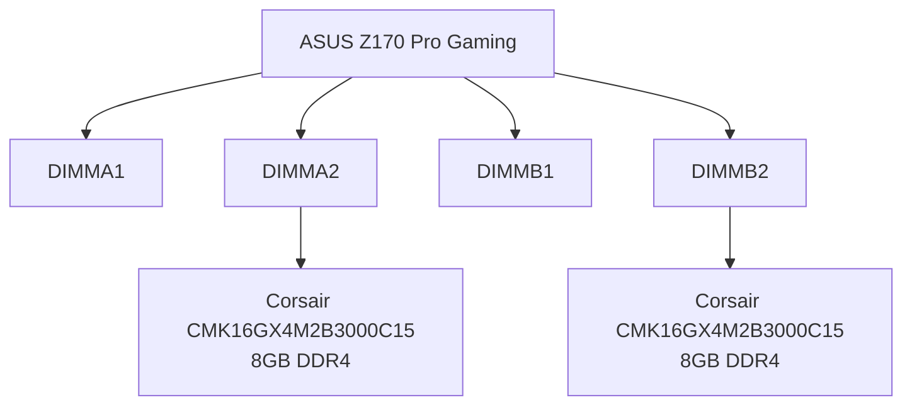

# DC01 Infrastructure Overview

`dc01` is the primary Domain Controller and secondary network storage for smith-lab.

* Role: `Domain Controller`
* Hostname: `dc01`
* OS: `Fedora Linux 44 (Server Edition)`
* Architecture: `x86_64`
* Motherboard: [`ASUS Z170 Pro Gaming`](https://www.asus.com/us/supportonly/z170_pro_gaming/helpdesk_manual/)
* Storage: `10.01TB`
* Encryption: `None`
* Backups: `Enabled`

---

## CPU

* Model: [`Intel(R) Core(TM) i7-6700K`](https://www.intel.com/content/www/us/en/products/sku/88195/intel-core-i76700k-processor-8m-cache-up-to-4-20-ghz/specifications.html)
* Frequency: `4.00GHz`
* Cores: `4`
* Threads: `8`

---

## GPU

* Model: `NVIDIA GeForce GTX 750 Ti`
* AIB: `Zotac`
* Interface: `PCIe x16`

---

## RAM

* System Ram: `16GB`
* DIMM count: `2/4`
* Model (x2): [`Corsair CMK16GX4M2B3000C15`](https://www.corsair.com/us/en/p/memory/cmk16gx4m2b3000c15/vengeancea-lpx-16gb-2-x-8gb-ddr4-dram-3000mhz-c15-memory-kit-black-cmk16gx4m2b3000c15?srsltid=AYCX9vLluuEqDP3hFam9u8aTq3sHUjSE_Pm1FNJLdi3bIxBW20NtOh3W)

---

## Storage

--8<-- "docs/infrastructure/domain-controllers/dc01-storage.md"

---

## Network

* Interfaces: `2`
* Primary Interface: `enp0s31f6`
* Connection Name: `lan`
* Speed: `1Gbps`
* Media: `RJ45 Ethernet`

---

## PCIe Expansion

* PCIe x16 Slots Used: `1/3`
* PCIe x1 Slots Used: `0/3`
* SATA Ports Used: `3/6`
* M.2 Slots Used: `1/1`
