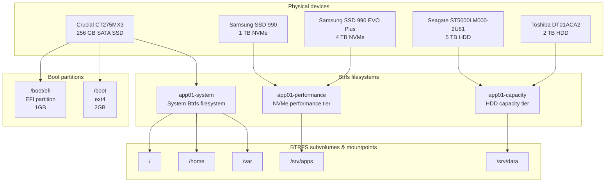

# Domain Controller OS Install

!!! warning

    Please refer to the [previous guide](../../os-media/index.md) if
    you have not installed Fedora Everything.

As of now, the preferred distribution of choice is [Fedora](https://fedoraproject.org/).
Specifically, Server Edition for Domain Controller devices.

It is required to have Fedora Everything installed, please refer to the warning
above if you do not have it installed.

---

## Install Steps

* Download, install, and flash USB drive with [Ventoy](../../../tools/os-tools/ventoy/index.md)
* Download and transfer [Fedora Everything](../../os-media/index.md)
  to Ventoy USB
* Power down target device
* Plug Ventoy USB into target device
* Enter the target device boot menu:
* In the Ventoy Grub menu, select **Fedora Everything**:
* Boot in **normal mode**:
* Select **Install Fedora** from GRUB menu

You will now be in the Fedora Anaconda installer.

---

### Welcome to Fedora

You will be greeted with the welcome menu screen. Here, you will select
your preferred language of choice for the installation.

---

### Installation Summary

This is the main menu you will be navigating throughout for the Fedora installation.
Here there are a series of menu sections, with sub sections offered beneath each
header.

---

#### Localization

##### Keyboard

By default, this will use the selected language at the [Welcome to Fedora]
(../hardware-specific/domain-controllers.md#welcome-to-fedora) menu.

If a new language is needed, select it from the menu options and use the provided
test input box to test keyboard input.

##### Language Support

By default, this will use the selected language at the [Welcome to Fedora]
(../hardware-specific/domain-controllers.md#welcome-to-fedora) menu.

If a new language is needed, select it from the menu options.

##### Time & Date

By default, this should be set to **Automatic date & time**. When using LAN,
this will connect to the automatic NTP server and configure time.

If reconfiguration is required:

* **Automatic date &time**
* Configure NTP:

!!! example

| Host Name | Pool | NTS | Working |
| --------- | ---- | --- | ------- |
| `2.fedora.pool.ntp.org` | :white_check_mark: | :cross_mark: | :white_check_mark: |

---

#### Software

##### Installation Source

By default, this should be set up to use the following:

* **On the network**
* **Updates**: Install the latest available software updates

If there is an error, open the menu, and configure to the above.

##### Software Selection

The Software Selection menu determines the role and feature set of the target device.

For Domain Controller deployments, use the following settings:

###### Base Environment

* **Fedora Server Edition**

###### Additional software for Selected Environment

* **Container Management**
* **Headless Management**
* **System Tools**

!!! tip

    Domain Controllers should be installed without a GUI desktop
    environment unless a specific use case requires one. This reduces resource
    usage, attack surface, and long-term maintenance requirements.

---

#### System

##### Installation Destination

###### Storage Configuration

Select: **Advanced Custom (Blivet-GUI)**

##### Network & Host Name

!!! warning

      You must be connected via ethernet!

* Choose the default ethernet connection
* Click **Configure**
* Rename 'Connection name' to **lan**
* Leave IPv4 set to Automatic (DHCP)
* Leave IPv6 set to Automatic

Edit **Host Name**:

* Enter: `dc01`
* Click: **Apply**

---

#### User Settings

##### Root Account

Leave as **Disabled**.

##### User Creation

* Full Name: `Domain Administrator`
* User name: `lab-admin`
* Password: `****`
* :white_check_mark: Add administrative privileges to this user account
  (wheel group membership)
* :white_check_mark: Require a password to use this account

---

## Begin Installation

When done with the different install menus, click **Begin Installation**
to start installing Fedora Server Edition.

This may take several minutes to complete. When the installation finishes, click
**Reboot System** to restart the server.
