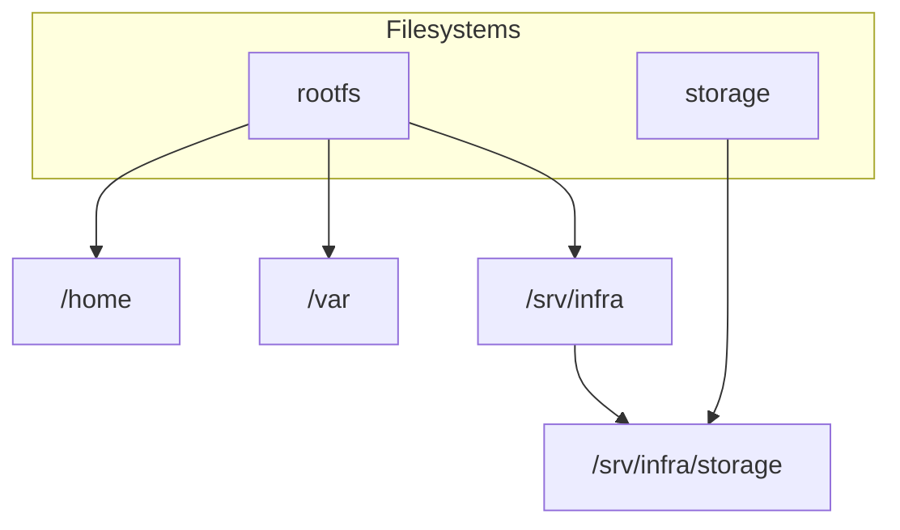

```Shell
lsblk -f
btrfs filesystem show
```

If shows: `device ... /dev/... MISSING`

```Shell
sudo btrfs device scan
btrfs filesystem show
```

Expected:

```Markdown
Label: 'rootfs' uuid: xxxx
        Total devices 1 ...
        devid    1 ... path /dev/sdb3

Label: 'storage' uuid: xxxx
        Total devices 3 ...
        devid    1 ... path /dev/sda1
        devid    2 ... path /dev/nvme0n1p1
        devid    3 ... path /dev/sdc1
```

Capture current state:

```shell
btrfs subvolume list /
df -h
findmnt -t btrfs
```

Document - should match as follows:



Install Samba

```shell
sudo dnf install -y samba samba-client
```
