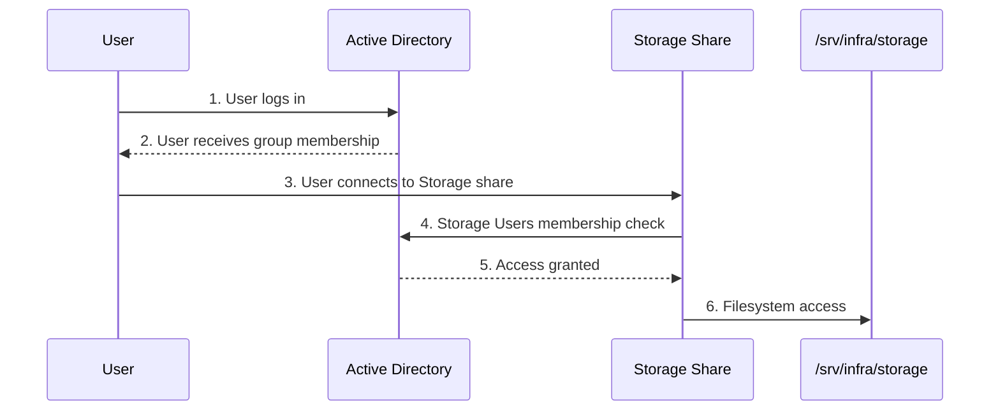

# Creating an SMB Share

## Prerequisites

* Samba AD DC operational
* DNS operational
* Kerberos operational
* User accounts created
* Access groups created

---

## Share Design

* Path: `/srv/infra/storage`
* Access Group: `Storage Users`



---

## Create Storage Directory

```shell
sudo mkdir -p /srv/infra/storage
```

Verify:

```shell
ls -ld /srv/infra/storage
```

---

## Verify Domain Access

Verify domain identities resolve correctly:

```shell
id <domain-user>
```

Verify the access group resolves:

```shell
getent group "Storage Users"
```

and domain users should resolve correctly.

!!! warning

    If domain users or groups do not resolve,
    verify domain join and SSSD/Winbind configuration
    before continuing.

---

## Create Share

Add to:

```text
/etc/samba/smb.conf
```

```ini
[Storage]
        path = /srv/infra/storage
        browseable = yes
        read only = no

        valid users = @"Storage Users"

        create mask = 0660
        directory mask = 0770
```

---

## Validate Configuration

```shell
sudo testparm
```

Expected:

```text
Loaded services file OK
```

Reload Samba:

```shell
sudo systemctl reload samba
```

---

## Test Access

Choose one or more validation methods.

### Linux

Validate Kerberos:

```shell
kinit csmith
klist
```

List shares:

```shell
smbclient -L //dc01 -k
```

Expected:

```text
Storage
sysvol
netlogon
```

Browse the share:

```shell
smbclient //dc01.smith-lab.xyz/Storage -k
```

List contents:

```shell
ls
```

Upload test file:

```shell
put test.txt
```

Exit:

```shell
quit
```

Verify access as a different user:

```shell
kdestroy

kinit csmith-admin
smbclient //dc01/Storage -k
```

### Windows

Windows Explorer:

```text
\\dc01\Storage
```

Authenticate using:

```text
SMITH-LAB\csmith
```

or

```text
SMITH-LAB\csmith-admin
```
