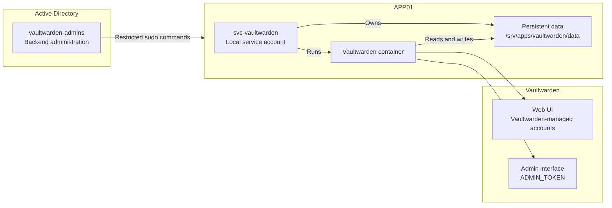

# Vaultwarden Setup

## Identity Model



---

## Create Service Account

Install Podman if needed:

```shell
sudo dnf install -y podman
```

Create the local account:

```shell
sudo useradd \
  --system \
  --create-home \
  --home-dir /srv/apps/vaultwarden \
  --shell /usr/sbin/nologin \
  svc-vaultwarden
```

Lock password authentication:

```shell
sudo passwd --lock svc-vaultwarden
```

Exclude the service account from session recordings:

```shell
sudo nano /etc/sssd/conf.d/sssd-session-recording.conf
```

Under `[session_recording]`, add:

```text
[session_recording]
scope = all
exclude_users = svc-vaultwarden
```

!!! note

    If `exclude_users` already exists, append the account with a comma

Restart SSSD:

```shell
sudo chmod 600 /etc/sssd/conf.d/sssd-session-recording.conf &&
sudo chown root:root /etc/sssd/conf.d/sssd-session-recording.conf &&
sudo sss_cache -E &&
sudo systemctl restart sssd
```

Verify:

```shell
getent passwd svc-vaultwarden
```

Create deployment directories:

```shell
sudo install -d \
  -o svc-vaultwarden \
  -g vaultwarden-admins \
  -m 0750 \
  /srv/apps/vaultwarden \
  /srv/apps/vaultwarden/data \
  /srv/apps/vaultwarden/config
```

Enable linger to run user-level systemd services when nobody is logged in:

```shell
sudo loginctl enable-linger svc-vaultwarden
```

Assign UID/GID ranges for rootless Podman:

```shell
sudo usermod \
  --add-subuids 100000-165535 \
  --add-subgids 100000-165535 \
  svc-vaultwarden
```

If that range is already assigned, use another unused block of 65,536 IDs.

To inspect existing subordinate-ID allocations:

```shell
sudo cat /etc/subuid &&
sudo cat /etc/subgid
```

Verify:

```shell
cd /srv/apps/vaultwarden &&
getent passwd svc-vaultwarden &&
sudo loginctl show-user svc-vaultwarden --property=Linger &&
sudo -u svc-vaultwarden podman info --format '{{.Host.Security.Rootless}}'
```

!!! info

    The directory for the `cd` command does not need to be `/srv/apps/vaultwarden`.
    The working directory chosen ***does*** need to be accessible by both the user
    running the command, and the `svc-vaultwarden` user.

Expected:

!!! quote ""

    Linger=yes  
    true
