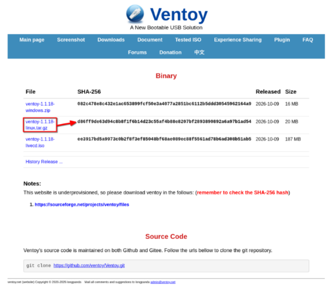
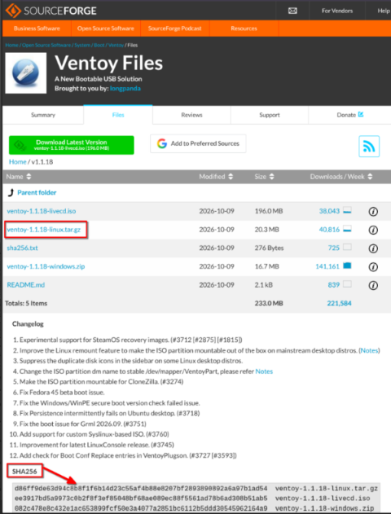
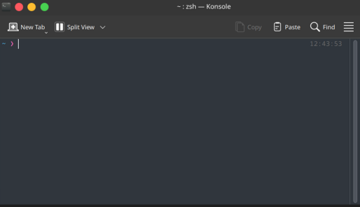
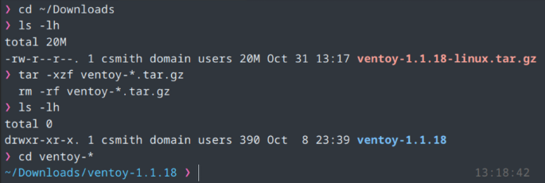
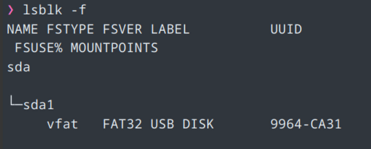
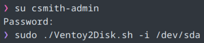
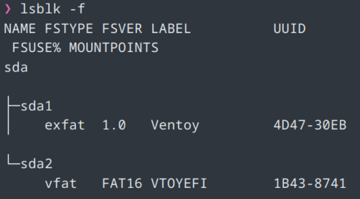

# Ventoy

[Ventoy](https://www.ventoy.net/en/index.html) is an open source tool
used to create on-the-go bootable USB drives.

It supports the following file formats:

* ISO
* WIM
* IMG
* VHD(x)
* EFI

Using Ventoy, there is no need to reformat the same disk over and over anymore.
Simply drag-and-drop files to the USB drive and boot directly.

You can copy as many files as your drive can hold, and can store them in any
folder structure you like. Ventoy provides a Grub Boot menu to select which
media you want to boot into.

## Installation

### Ventoy Site

* Visit the [downloads](https://www.ventoy.net/en/download.html) page
* Select the most recent binary:

!!! example

    

### Mirror Site

* This will bring you to a SourceForge mirror site. Select the same versioned
`tar.gz` file:

!!! example

    

* Expected result:

!!! example

    

---

## Configuration

* Open a terminal (`CTRL` + `ALT` + `T`):

!!! example

    

* Extract the archive in `~/Downloads`:

!!! example

    ```shell
      cd ~/Downloads
      ls -lh
      tar -xzf ventoy-*.tar.gz
      rm -rf ventoy-*.tar.gz
      ls -lh
      cd ventoy-*
    ```

    

* Insert the USB drive
* Identify the device:

!!! example

    ```shell
      lsblk -f
    ```

    

* Switch to `csmith-admin` (don't include `-` to keep current `pwd`):

!!! example

    ```shell
      su csmith-admin
    ```

* Run script:

!!! example

    ```shell
      sudo ./Ventoy2Disk.sh -i /dev/sdX
      exit
    ```

    

## Validation

* Validate partition layout:

```shell
  lsblk -f
```

* Expected result:

!!! example

    
